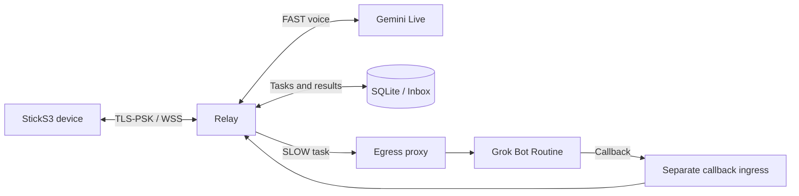
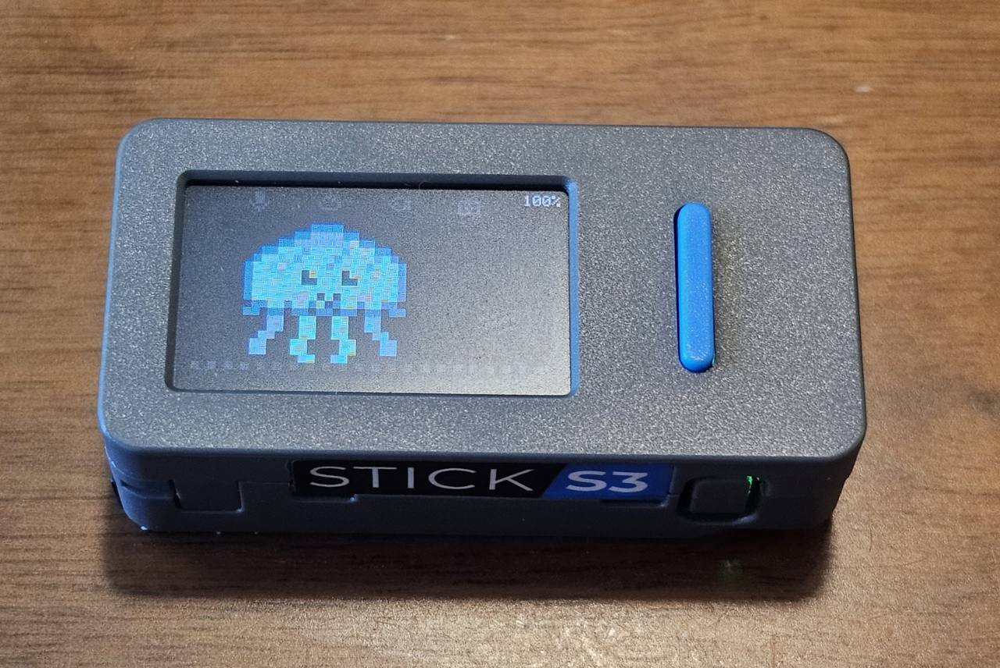

# Amusant

English | [繁體中文](README.zh-TW.md)

Amusant is an open-source AI voice companion project. Jellii is the companion built with Amusant, running on the M5Stack M5StickS3.

Jellii is an experimental push-to-talk companion connecting a StickS3 device to Gemini Live voice and delegated Grok Bot tasks through a self-hosted relay.



The callback ingress is a separately configured boundary; the sample Compose file does not publish it. The supported slow executor is `grok_callback`; missing or unsupported profiles fail closed. This is experimental Public Alpha source, not an approved production deployment.

## Hardware

Jellii uses the **M5Stack M5StickS3 (SKU K150)**, a compact ESP32-S3 device with 8 MB Flash, 8 MB PSRAM, a 1.14-inch 135 × 240 LCD, microphone, speaker, 2.4 GHz Wi-Fi, Bluetooth Low Energy (BLE), and a 250 mAh battery.



Hold the front **A** button to talk and release to send. The side **B** button wakes the screen and can read an unread Inbox result; from Idle or Offline, hold B for five seconds to enter Wi-Fi setup. If the screen is off, wake it first.

[M5Stack product page](https://shop.m5stack.com/products/m5sticks3-esp32s3-mini-iot-dev-kit) · [Official hardware documentation](https://docs.m5stack.com/en/core/StickS3)

## Build Your Own Jellii

**First-time builder? Follow the [Local-first Quick Start](docs/local-first.md): Linux PC + StickS3 + Gemini API key → Docker → Flash → BLE Wi-Fi → first spoken FAST answer.** No domain, public inbound ports or cloud server required. After FAST, add Grok Callback using a temporary HTTPS tunnel or follow the [ARM64 / OCI advanced deployment](docs/build-your-own-jellii.md).


**Owner-reported physical validation (2026-11-10):** An existing legacy OCI deployment used Tailscale Funnel raw TCP on port 10000 as its primary device ingress (an optional path for other deployments); FAST across Wi-Fi networks, FAST Google Search, Grok dispatch, Callback, Inbox and Button B readback passed. A persistent host forwarder carried device traffic to the existing private TLS-PSK Relay ingress. The Owner enabled Gemini Google Search in that deployment; its Relay image is a legacy image, not evidence that this public repository's current `main` was deployed. Funnel cold start and closure of direct public TCP 443 were not verified. FAST/SLOW intent routing remains imperfect.

Grok Bot does not accept an Owner approval embedded in a webhook payload as authorization to create a Routine; approve such actions separately in a trusted Grok interface. Prompts do not bypass this boundary. See [device ingress boundaries](docs/device-ingress-safety.md).

Amusant has already passed **owner-operated local StickS3/Gemini FAST physical E2E** and **OCI StickS3/Gemini/Grok/Callback/Inbox physical E2E**. The public setup instructions have **not yet been independently clean-room reproduced**; these are separate claims.

## Jellii screens

| Idle | Listening | Thinking |
| --- | --- | --- |
|  |  |  |

| Speaking | Sleeping | Offline |
| --- | --- | --- |
|  |  |  |

*Rendered design previews based on the pinned Kai display layout, not captures from a physical device. Text and indicators are illustrative.*

## Features

- **Voice path:** Gemini Live with a push-to-talk device protocol.
- **Delegated tasks:** Grok Bot Routine submissions and authenticated callback receipts.
- **Durable results:** SQLite task ledger and Inbox with owner-scoped access.
- **Device transport:** TLS-PSK and WSS, with an egress proxy for outbound traffic.
- **Offline verification:** fake provider, callback, storage and device tests; pinned Kai firmware patch and host checks.

## What you can do

Press and hold the device button to speak, then release it. When the system is configured, a short voice question can be handled by Gemini Live. A request that needs background work can be delegated to the configured Grok Bot Routine; later, ask for the task status or retrieve a saved Inbox result.

| Example request | Intended path | What to expect |
| --- | --- | --- |
| “Explain what a solar eclipse is.” | FAST: Gemini Live | A spoken response; captions can appear on the device. |
| “Compare three ways to organize a small project and summarize the tradeoffs.” | SLOW: Grok Bot Routine | Relay acknowledges only after the task is durably admitted; the configured Routine performs the work. |
| “What is the status of my last task?” | Inbox lookup | Relay reports the saved status without submitting a new task. |
| “Read the result of my last task.” | Inbox lookup | If a result is available, the device can request it to be read aloud. |
| “Cancel my current task.” | Task control | Before submission, Relay can cancel locally. After submission, Grok Bot has no remote stop control; Relay reports the outcome as uncertain until a callback or owner reconciliation. |

These are illustrative requests, not a guarantee of routing, response time, accuracy, or a particular Routine capability. A working deployment must supply its own Gemini and Grok Bot configuration and independently configured device and callback ingress. Device behavior still requires physical validation. Unlike the upstream Kai project, this candidate does not claim support for Kai's Hermes memory, reminders, schedules, watches, or built-in local-data tools.

### Fast and slow paths

| | FAST voice | SLOW delegated task |
| --- | --- | --- |
| Provider | Gemini Live | Configured Grok Bot Routine |
| Use | Conversational voice response | Work delegated for later retrieval |
| Result | Spoken response and optional caption | Callback recorded in SQLite, then available through Inbox |
| Failure boundary | Provider or connectivity failure is reported as unavailable | Unknown submissions are not automatically retried; a missing callback can leave a task uncertain |

The firmware patch builds on [Kai](https://github.com/zbruceli/kai) at its pinned v0.12.0 revision. Amusant's Grok Bot callback flow and supported feature set differ from upstream Kai; see [Architecture](docs/architecture.md) and [third-party notices](NOTICE.md).

## Quick start: offline tests

Install Python 3.13 and [uv](https://docs.astral.sh/uv/), then from the repository root:

```sh
uv sync --locked --extra hardware-opus --group dev
uv run --locked python -m unittest relay.tests.test_grok_callback relay.tests.test_inbox fast_voice.tests.test_contract
```

These tests use synthetic data and fake providers; they do not require real provider credentials. See [Quick start](docs/quickstart.md) for the full offline CI selection and manual builds.

## Documentation

- [Architecture and data flow](docs/architecture.md)
- [Configuration and safety](docs/configuration.md)
- [Offline tests and builds](docs/quickstart.md)
- [Firmware build](patches/amusant-sticks3-base-v0.12.0.md)
- **[Build Your Own Jellii — Local-first Quick Start](docs/local-first.md)**
- [Advanced: ARM64 / OCI-style deployment](docs/build-your-own-jellii.md)
- [Self-hosting architecture and limits](docs/self-hosting.md)
- [StickS3 BLE/QR Wi-Fi provisioning and USB recovery](docs/wifi-provisioning.md)
- [Contributing](CONTRIBUTING.md) and [security](SECURITY.md)
- [Third-party notices](NOTICE.md)

## Repository layout

```text
fast_voice/    Gemini Live provider and voice contracts
relay/         device, callback, task and Inbox runtime
relay/tests/   offline runtime and safety tests
deploy/        Dockerfiles, Compose and example settings
patches/       consolidated firmware patch and host regressions
docs/          architecture, configuration and quick start
third_party/   applicable upstream license notices
```

Some compatibility code remains for historical data and testing; it is not a supported public backend. The base Compose has deliberately invalid endpoint placeholders; the local-first and advanced guides supply distinct, explicitly selected runtime configurations.

## License

Amusant-owned code is released under the [MIT License](LICENSE). Third-party components retain their own terms; see [NOTICE.md](NOTICE.md). Firmware binaries may require additional notices for their actual bundled dependencies.
