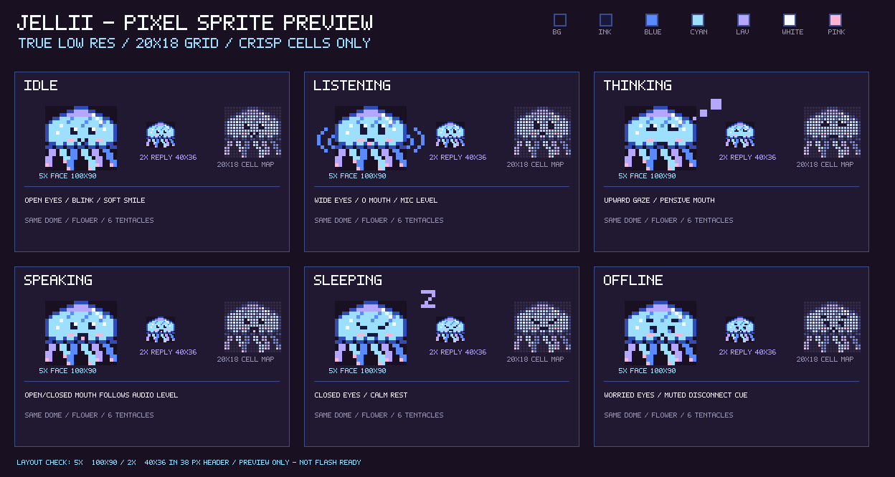

# Amusant

English | [繁體中文](README.zh-TW.md)

An experimental push-to-talk companion connecting a StickS3 device to Gemini Live voice and delegated Grok tasks through a self-hosted relay.

```text
 +-----------+   TLS-PSK / WSS   +----------------------+
 |  StickS3  | <---------------> | Relay                |
 |  device   |                   |  - Gemini Live (FAST)| ---> Gemini Live
 +-----------+                   |  - SQLite + Inbox    |
                                 |  - Grok callback     |
                                 +----------+-----------+
                                            | delegated task
                                            v
                                 +----------------------+
                                 | Egress proxy         | ---> Grok Routine
                                 +----------------------+         |
                                          callback ingress <------+
```

The callback ingress is a separately configured boundary; the sample Compose file does not publish it. The supported slow executor is `grok_callback`; missing or unsupported profiles fail closed. The project is a staging candidate, not an approved production deployment.

## Jellii states



*Design preview of Jellii's device states; the image is illustrative, not a photograph of a running device.*

## Features

- **Voice path:** Gemini Live with a push-to-talk device protocol.
- **Delegated tasks:** Grok Routine submissions and authenticated callback receipts.
- **Durable results:** SQLite task ledger and Inbox with owner-scoped access.
- **Device transport:** TLS-PSK and WSS, with an egress proxy for outbound traffic.
- **Offline verification:** fake provider, callback, storage and device tests; pinned Kai firmware patch and host checks.

## What you can do

Press and hold the device button to speak, then release it. When the system is configured, a short voice question can be handled by Gemini Live. A request that needs background work can be delegated to the configured Grok Routine; later, ask for the task status or retrieve a saved Inbox result.

| Example request | Intended path | What to expect |
| --- | --- | --- |
| “Explain what a solar eclipse is.” | FAST: Gemini Live | A spoken response; captions can appear on the device. |
| “Compare three ways to organize a small project and summarize the tradeoffs.” | SLOW: Grok Routine | Relay acknowledges only after the task is durably admitted; the configured Routine performs the work. |
| “What is the status of my last task?” | Inbox lookup | Relay reports the saved status without submitting a new task. |
| “Read the result of my last task.” | Inbox lookup | If a result is available, the device can request it to be read aloud. |
| “Cancel my current task.” | Task control | Before submission, Relay can cancel locally. After submission, Grok has no remote stop control; Relay reports the outcome as uncertain until a callback or owner reconciliation. |

These are illustrative requests, not a guarantee of routing, response time, accuracy, or a particular Routine capability. A working deployment must supply its own Gemini and Grok configuration and independently configured device and callback ingress. Device behavior still requires physical validation. Unlike the upstream Kai project, this candidate does not claim support for Kai's Hermes memory, reminders, schedules, watches, or built-in local-data tools.

### Fast and slow paths

| | FAST voice | SLOW delegated task |
| --- | --- | --- |
| Provider | Gemini Live | Configured Grok Routine |
| Use | Conversational voice response | Work delegated for later retrieval |
| Result | Spoken response and optional caption | Callback recorded in SQLite, then available through Inbox |
| Failure boundary | Provider or connectivity failure is reported as unavailable | Unknown submissions are not automatically retried; a missing callback can leave a task uncertain |

The firmware patch builds on [Kai](https://github.com/zbruceli/kai) at its pinned v0.12.0 revision. Amusant's Grok callback flow and supported feature set differ from upstream Kai; see [Architecture](docs/architecture.md) and [third-party notices](NOTICE.md).

## Quick start: offline tests

Install Python 3.13 and [uv](https://docs.astral.sh/uv/), then from the repository root:

```sh
uv sync --locked --extra hardware-opus --group dev
uv run --locked python -m unittest relay.tests.test_grok_callback relay.tests.test_inbox fast_voice.tests.test_contract
```

These tests use synthetic data and fake providers; they do not require real provider credentials. See [Quick start](docs/quickstart.md) for the full offline CI selection and manual builds.

## Documentation

- [Architecture and data flow](docs/architecture.md)
- [Configuration and safety](docs/configuration.md)
- [Offline tests and builds](docs/quickstart.md)
- [Firmware build](patches/amusant-sticks3-base-v0.12.0.md)
- [Contributing](CONTRIBUTING.md) and [security](SECURITY.md)
- [Third-party notices](NOTICE.md)

## Repository layout

```text
fast_voice/    Gemini Live provider and voice contracts
relay/         device, callback, task and Inbox runtime
relay/tests/   offline runtime and safety tests
deploy/        Dockerfiles, Compose and example settings
patches/       consolidated firmware patch and host regressions
docs/          architecture, configuration and quick start
third_party/   applicable upstream license notices
```

Some compatibility code remains for historical data and testing; it is not a supported public backend. The Compose example has deliberately invalid image and endpoint placeholders and requires separately designed device and callback ingress.

## License

Amusant-owned code is released under the [MIT License](LICENSE). Third-party components retain their own terms; see [NOTICE.md](NOTICE.md). Firmware binaries may require additional notices for their actual bundled dependencies.
