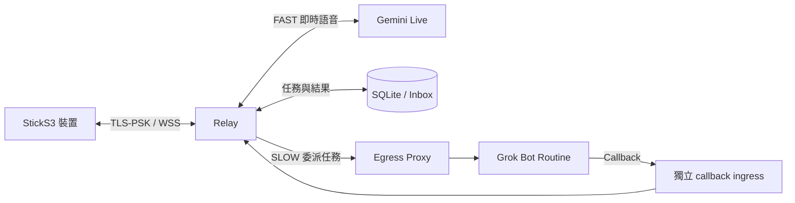

# Amusant

[English](README.md) | 繁體中文

Amusant 是實驗性的按鍵通話夥伴，透過自架 Relay 連接 StickS3、Gemini Live 語音與 Grok Bot 委派任務。



Callback ingress 需另外設定；Compose 範例沒有公開該連接埠。支援的慢速執行器為 `grok_callback`；設定缺失或不支援時會 fail-closed。本專案為實驗性 Public Alpha 原始碼，尚未核准正式生產部署。

## Jellii 畫面

| 待機 | 聆聽 | 思考 |
| --- | --- | --- |
|  |  |  |

| 說話 | 睡眠 | 離線 |
| --- | --- | --- |
|  |  |  |

*根據固定版本 Kai 顯示版面製作的設計預覽，並非實體裝置畫面；文字與狀態指示僅供示意。*

## 功能

- **語音路徑：** Gemini Live 與按鍵通話裝置協定。
- **委派任務：** Grok Bot Routine 提交與具驗證機制的 callback。
- **持久化結果：** SQLite 任務紀錄及依使用者區分的 Inbox。
- **裝置傳輸：** TLS-PSK、WSS 與出站 Egress Proxy。
- **離線驗證：** 假 Provider、callback、儲存及裝置測試，搭配固定 Kai 韌體 patch 與 host 測試。

## Amusant 可以做什麼？

設定完成後，按住裝置按鈕說話、放開送出。簡短的語音問題可由 Gemini Live 處理；需要背景工作的請求則可交給設定好的 Grok Bot Routine，之後再詢問任務狀態或讀取 Inbox 中的結果。

| 你可以這樣說 | 預期路徑 | 預期行為 |
| --- | --- | --- |
| 「解釋一下什麼是日食。」 | FAST：Gemini Live | 語音回覆，裝置可顯示字幕。 |
| 「比較三種整理小型專案的方法，摘要各自的優缺點。」 | SLOW：Grok Bot Routine | 任務持久化接收後才回報已接受；後續工作由設定的 Routine 執行。 |
| 「我上一個任務的進度如何？」 | Inbox 查詢 | 回報已儲存的狀態，不會因此提交新任務。 |
| 「讀出我上一個任務的結果。」 | Inbox 查詢 | 有可用結果時，可要求裝置以語音讀出。 |
| 「取消目前的任務。」 | 任務控制 | 送出前 Relay 可在本地取消；送出後 Grok Bot 沒有遠端停止控制，Relay 會如實回報不確定，直到收到 callback 或 Owner 對帳處理。 |

以上是示意請求，不保證模型一定選對路徑、回應時間、答案正確性或特定 Routine 能力。實際部署需自行設定 Gemini、Grok Bot，並另外完成裝置與 callback ingress；裝置行為仍需實機驗證。與上游 Kai 不同，本候選不宣稱支援 Kai 的 Hermes 記憶、提醒、排程、監測或內建在地資料工具。

### FAST 與 SLOW 路徑

| | FAST 即時語音 | SLOW 委派任務 |
| --- | --- | --- |
| Provider | Gemini Live | 設定的 Grok Bot Routine |
| 適合 | 語音對話與即時回覆 | 可稍後查詢結果的委派工作 |
| 結果 | 語音回應與可選字幕 | Callback 寫入 SQLite，再由 Inbox 讀取 |
| 失敗邊界 | Provider 或連線失敗時回報無法使用 | 提交狀態未知時不自動重送；缺少 callback 可能使任務維持不確定 |

韌體 patch 建立於固定的 [Kai](https://github.com/zbruceli/kai) v0.12.0 版本。Amusant 的 Grok Bot callback 流程與支援功能不同於上游 Kai；詳見[架構](docs/architecture.zh-TW.md)及[第三方聲明](NOTICE.md)。

## 快速開始：離線測試

安裝 Python 3.13 與 [uv](https://docs.astral.sh/uv/)，在 repository 根目錄執行：

```sh
uv sync --locked --extra hardware-opus --group dev
uv run --locked python -m unittest relay.tests.test_grok_callback relay.tests.test_inbox fast_voice.tests.test_contract
```

測試使用合成資料與假 Provider，不需要真實 Provider 憑證。完整離線 CI 選集與手動建置方式見[快速開始](docs/quickstart.zh-TW.md)。

## 文件

- [架構與資料流程](docs/architecture.zh-TW.md)
- [設定與安全邊界](docs/configuration.zh-TW.md)
- [離線測試與建置](docs/quickstart.zh-TW.md)
- [韌體建置](patches/amusant-sticks3-base-v0.12.0.md)
- [自行架設指引（進階，非一鍵部署）](docs/self-hosting.zh-TW.md)
- [StickS3 BLE／QR Wi-Fi 配網與 USB 備援](docs/wifi-provisioning.zh-TW.md)
- [參與貢獻](CONTRIBUTING.md)與[安全政策](SECURITY.md)
- [第三方聲明](NOTICE.md)

## Repository 結構

```text
fast_voice/    Gemini Live Provider 與語音介面
relay/         裝置、callback、任務及 Inbox runtime
relay/tests/   離線 runtime 與安全測試
deploy/        Dockerfile、Compose 與範例設定
patches/       整合韌體 patch 與 host regression
docs/          架構、設定及快速開始
third_party/   上游授權聲明
```

Repository 保留部分歷史資料相容與測試程式，不代表支援這些舊後端。Compose 範例的 image 與服務網址刻意設為無效 placeholder，裝置與 callback ingress 必須另行設計。

## 授權

Amusant 自有程式採用 [MIT License](LICENSE)。第三方內容仍適用各自條款，詳見 [NOTICE.md](NOTICE.md)；發行韌體 binary 時可能需要額外的依賴聲明。
