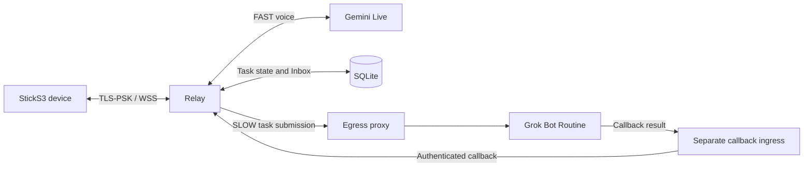

# Architecture and data flow

The Relay owns authenticated device sessions and stores task state in SQLite. A delegated task is acknowledged after durable admission; an uncertain submission is not automatically replayed. The callback receiver authenticates a task-bound capability and handles duplicate results. The device can retrieve saved results from its own Inbox.

The egress proxy controls outbound connections. Device and callback ingress must be provided and secured separately; the Compose sample does not expose ports. Runtime startup requires an explicit `grok_callback` executor. Compatibility code present in the tree is not a public support promise.

For configuration boundaries see [Configuration](configuration.md); for tests and builds see [Quick start](quickstart.md).

## Optional Funnel device ingress

In an Owner-reported 2026-11-10 physical test, the legacy deployment used as its primary device ingress Funnel raw TCP/10000 → persistent host forwarder → private host ingress TCP/443 → Relay TLS-PSK/WSS TCP/8443; FAST worked across Wi-Fi networks. Callback uses a separate authenticated ingress. This optional topology does not replace the local-first or direct-publish examples. It describes an existing legacy OCI deployment, not deployment of this repository's current `main`; cold-start behavior and closure of direct public TCP 443 were not established.
