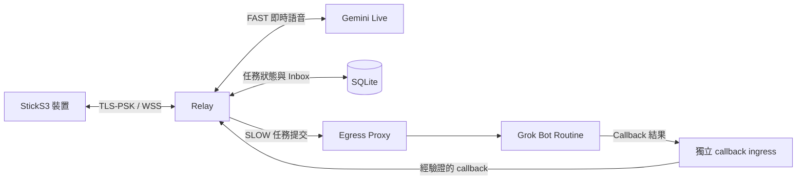

# 架構與資料流程

Relay 管理經驗證的裝置連線，並以 SQLite 儲存任務狀態。任務持久化接收後才回報已接受；提交結果不確定時不會自動重送。Callback receiver 驗證任務專屬 capability 並處理重複回報；裝置可讀取所屬使用者的 Inbox 結果。

Egress Proxy 控制出站連線。裝置與 callback ingress 需另行提供並保護；Compose 範例沒有發布連接埠。啟動時必須明確選擇 `grok_callback`。Repository 內的相容程式不代表公開支援這些舊後端。

參閱[設定與安全](configuration.zh-TW.md)及[離線測試與建置](quickstart.zh-TW.md)。
