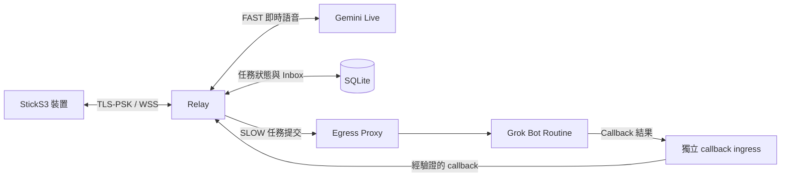

# 架構與資料流程

Relay 管理經驗證的裝置連線，並以 SQLite 儲存任務狀態。任務持久化接收後才回報已接受；提交結果不確定時不會自動重送。Callback receiver 驗證任務專屬 capability 並處理重複回報；裝置可讀取所屬使用者的 Inbox 結果。

Egress Proxy 控制出站連線。裝置與 callback ingress 需另行提供並保護；Compose 範例沒有發布連接埠。啟動時必須明確選擇 `grok_callback`。Repository 內的相容程式不代表公開支援這些舊後端。

參閱[設定與安全](configuration.zh-TW.md)及[離線測試與建置](quickstart.zh-TW.md)。

## 可選 Funnel 裝置入口

依 Owner 於 2026-11-10 的實機回報，既有舊版部署的主要裝置入口採用 Funnel raw TCP/10000 → 主機常駐轉送器 → 私有主機入口 TCP/443 → Relay TLS-PSK/WSS TCP/8443 連線，FAST 跨 Wi-Fi 測試通過。Callback 維持獨立驗證的入口。此可選拓撲不取代 local-first 或直接發布範例；它描述既有舊版 OCI 部署，不代表本 repo 目前 `main` 已部署，亦未驗證 Funnel 冷啟動或直接公網 TCP 443 是否關閉。
